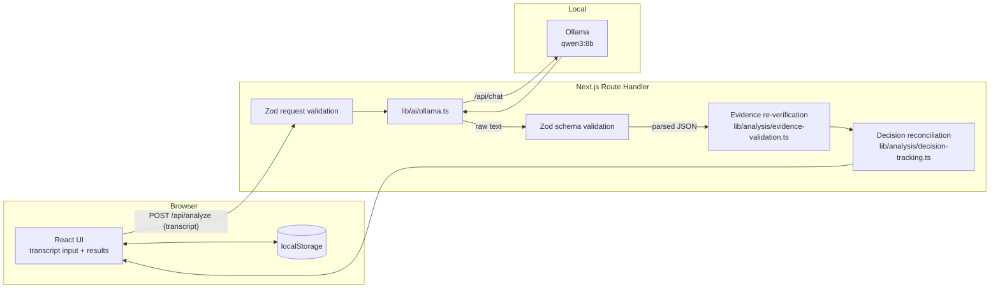

# MeetTrace — AI Meeting Intelligence (MVP)

> Turn unstructured meeting prose into traceable decisions, grounded
> actions, and verifiable evidence. Runs locally with Ollama by
> default, or against any OpenAI-compatible cloud provider
> (OpenRouter, Groq, etc.) for production deployments.

## Overview

MeetTrace is a focused MVP for a single, hard problem: **understanding
how a meeting decision actually evolved**, not just what was discussed.
Most meeting summarizers treat every alternative equally and produce a
fluent summary that is hard to audit. MeetTrace does the opposite:

- It tracks each decision from **proposal → challenge → confirmation →
  supersession**, surfacing the *final* decision only when the transcript
  contains explicit confirmation.
- It grounds every extracted item in an **exact excerpt** of the original
  transcript. The server re-verifies every excerpt; the UI marks any
  that fail verification as unverified and forces a human review.
- It refuses to invent owners, deadlines, speakers, timestamps, or final
  decisions. Unknown fields stay `null`, ambiguous cases are flagged.

The default path is local-only through Ollama — no meeting text ever
leaves the user's machine and no external API key is required. For
deployments (Vercel, a shared VPS, ...) the same app can be switched
to **OpenRouter** with a single env var; the rest of the pipeline
(validation, evidence verification, decision reconciliation) is
provider-agnostic.

## Why decision evolution and evidence matter

A typical meeting note might say "We discussed databases and chose SQL
Server." That sentence is almost never enough:

- Did someone else propose PostgreSQL? When was it dropped?
- Was the choice actually *decided*, or did the meeting end with two
  unresolved options and we are inferring the winner?
- Who owns the follow-up, and by when?
- Which sentence in the transcript is the actual proof?

MeetTrace is designed to answer those questions, and to admit when it
cannot.

## LLM providers

MeetTrace talks to the LLM through a small provider interface
(`lib/ai/provider.ts`). Two implementations ship in the box:

| Provider        | `LLM_PROVIDER` | Best for                                  | Data leaves your machine? |
| --------------- | -------------- | ----------------------------------------- | ------------------------- |
| **Ollama**      | `ollama`       | Local dev, offline, private meetings      | **No** (local 127.0.0.1)  |
| **OpenRouter**  | `openrouter`   | Vercel / serverless / quick demos         | Yes (TLS to OpenRouter)   |

The route handler is provider-agnostic: validation, evidence
re-verification, and decision reconciliation run identically in both
modes. The provider is selected at request time from `LLM_PROVIDER`
(default: `openrouter` when `OPENROUTER_API_KEY` is set, otherwise
`ollama`).

### Switching providers

```bash
# Local Ollama (default when OPENROUTER_API_KEY is unset)
LLM_PROVIDER=ollama
OLLAMA_MODEL=qwen3:8b

# Cloud via OpenRouter
LLM_PROVIDER=openrouter
OPENROUTER_API_KEY=sk-or-v1-...
OPENROUTER_MODEL=qwen/qwen-2.5-7b-instruct
```

`GET /api/analyze` reports which provider the server is currently
using, so you can confirm the switch worked.

### Why OpenRouter for the cloud path

- One key, hundreds of models. Easy to swap `qwen/qwen-2.5-7b-instruct`
  for `meta-llama/llama-3.1-8b-instruct` or `google/gemini-flash-1.5`
  without code changes.
- OpenAI-compatible API surface — if you outgrow OpenRouter, the same
  provider code works against Groq, OpenAI, or any self-hosted
  OpenAI-compatible endpoint (set `OPENROUTER_BASE_URL`).
- Free tier includes `qwen-2.5-7b-instruct` at generous rate limits.
- Strict JSON output enforced via `response_format: { type: "json_object" }`
  so the Zod schema validation is reliable.

## Key features

- One-page Next.js + TypeScript app (App Router, strict types).
- Vietnamese UI, English code and docs.
- Large textarea + two built-in sample transcripts (one with an
  explicit final decision, one with unresolved alternatives).
- Server-side AI pipeline through `/api/analyze` — Ollama is never
  contacted from the browser.
- Structured JSON output validated by Zod, with graceful handling of
  parse errors, schema mismatches, timeouts, empty responses, missing
  model, and unreachable Ollama.
- Server-side **evidence re-verification**: every `excerpt` is looked
  up in the original transcript. Unverified evidence is flagged in the
  UI and forces a human review.
- Deterministic **decision reconciliation**: the latest entry with
  status `confirmed` becomes the final decision; the model-declared
  `isFinal` is treated as a hint, not as the truth.
- Six UI sections: Final Decisions, Decision History, Action Items,
  Issues, Requests & Feedback, Open Questions.
- Users can edit any extracted description, mark items as confirmed or
  "needs review", and visually distinguish AI-suggested text from
  human-edited text.
- Last transcript + results persist in `localStorage`. No database, no
  cross-device sync, no claim of durability.
- Vitest test suite covering the five required cases plus parsing and
  pipeline plumbing — runs offline without Ollama.

## Architecture and data flow



The pipeline is:

1. **Validation** — request body, transcript length, non-empty.
2. **Model availability** — `/api/tags` ensures `qwen3:8b` is installed.
3. **AI extraction** — `/api/chat` with a strict system prompt and a
   `format: "json"` payload.
4. **Schema validation** — Zod rejects malformed responses.
5. **Evidence verification** — every `excerpt` is checked against the
   original transcript on the server. Smart-quote and whitespace drift
   are tolerated, but anything that cannot be located is marked
   unverified.
6. **Decision reconciliation** — deterministic rules promote the latest
   confirmed entry to the final decision and supersede prior proposals
   on the same topic. Model-declared "final" entries that disagree are
   downgraded and surfaced as warnings.
7. **Response** — the UI receives the validated, verified analysis.

## Tech stack

- Next.js 14 (App Router) + React 18 + TypeScript (strict).
- Tailwind CSS for styling.
- Zod for input and output validation.
- Ollama (`qwen3:8b` by default) for local inference.
- Vitest for unit and pipeline tests.

## Prerequisites

- Node.js **>= 20** (tested on 20.19.5).
- npm 10+.
- [Ollama](https://ollama.com/download) installed and running locally
  (`ollama serve` or the desktop app). The default endpoint is
  `http://127.0.0.1:11434`.
- At least 8 GB of free RAM for `qwen3:8b`. A GPU is not required but
  will make inference much faster.

## Setup

```bash
# 1. Install dependencies
npm install

# 2. Pull the model (only needed once)
ollama pull qwen3:8b

# 3. Make sure Ollama is running
ollama serve     # or start the desktop app

# 4. (optional) copy env template
cp .env.example .env.local
```

Environment variables (all optional except `OPENROUTER_API_KEY` when
using the cloud provider):

| Variable                 | Default                                  | Purpose                                              |
| ------------------------ | ---------------------------------------- | ---------------------------------------------------- |
| `LLM_PROVIDER`           | `openrouter` (if key set) else `ollama`  | Which provider to use.                               |
| `OPENROUTER_API_KEY`     | *(none)*                                 | OpenRouter key. Required for cloud mode.             |
| `OPENROUTER_MODEL`       | `qwen/qwen-2.5-7b-instruct`              | OpenRouter model id.                                 |
| `OPENROUTER_BASE_URL`    | `https://openrouter.ai/api/v1`           | Override for self-hosted OpenAI-compatible APIs.     |
| `OLLAMA_BASE_URL`        | `http://127.0.0.1:11434`                 | Ollama endpoint. Used only in local mode.            |
| `OLLAMA_MODEL`           | `qwen3:8b`                               | Local Ollama model.                                  |
| `MEETTRACE_MAX_CHARS`    | `60000`                                  | Hard limit on transcript length accepted by the API. |
| `MEETTRACE_TIMEOUT_MS`   | `120000`                                 | Per-request timeout. Local Ollama defaults to 6×.    |

## Run

```bash
# Development
npm run dev

# Production
npm run build
npm start
```

Open <http://localhost:3000>.

## Tests

```bash
# All tests (Vitest, no Ollama required)
npm test

# TypeScript check
npm run typecheck

# Lint
npm run lint
```

## Sample usage

The two built-in samples live in `public/samples/`:

- `clear-decision.txt` — explicit proposal → challenge → confirmation
  flow (PostgreSQL → SQL Server).
- `ambiguous-decision.txt` — three alternatives discussed, no
  confirmation; an unresolved performance issue; an undecided request.

Click the **Mẫu: chốt rõ** / **Mẫu: mơ hồ** buttons in the UI to load
them. The Analyze Meeting button always calls the real local model —
the samples are inputs only, not pre-canned results.

## Test results

The five required cases from the spec are implemented as automated
tests under `tests/`. They run offline by stubbing `fetch`, so they
never need Ollama. The table below reports the actual state of the
test suite on this machine.

| # | Test | Expected | Actual | Result | Lesson learned |
| - | ---- | -------- | ------ | ------ | -------------- |
| 1 | Successful decision change (PostgreSQL → SQL Server) | SQL Server is the final decision; PostgreSQL is not in `finalDecisions` and is marked `superseded` in `decisionHistory`. | Reconciler returned `finalDecisionIds = ["dh3"]`; PostgreSQL entry downgraded to `superseded`. | ✅ Pass | The latest `confirmed` history entry is the only candidate for "final", even if the model pre-declares something else. |
| 2 | Action extraction (Binh prepares a plan before Friday) | `assignee = "Binh"`, `deadline = "before Friday"`, description refers to the plan. | Action item retained both fields and the description; evidence excerpt matched the transcript. | ✅ Pass | Only fields explicitly supported by the transcript should be filled in; null otherwise. |
| 3 | Ambiguous disagreement (Chart.js / Recharts / D3, no confirmation) | `finalDecisions` empty, `needsReview = true`, at least one warning. | Final list was empty, `needsReview = true`, warning emitted. | ✅ Pass | An unconfirmed meeting must not produce a final decision, no matter how strongly the latest option is phrased. |
| 4 | Missing owner / deadline | `assignee` and `deadline` stay `null`; item is flagged for review. | Fields stayed `null`; `needsReview = true`. | ✅ Pass | The reconciler must not invent fields the transcript did not name. |
| 5 | Evidence failure (fabricated quote about MongoDB) | Excerpt is rejected; the item is flagged for review. | `verifyAllEvidence` returned `anyUnverified = true`; the item was marked for human review. | ✅ Pass | "The model said so" is never enough — the server must locate the excerpt in the original transcript. |

Additional tests (all in `tests/analysis.test.ts`) cover the JSON
extractor, transcript length validation, chunking, mocked chat
completion success/failure paths, schema rejection, and the full
end-to-end `analyzeTranscript` flow with a stubbed Ollama. The full
suite is **33 / 33 passing**.

> **Manual model evaluation was attempted on this machine but is
> reported honestly, not as a passing test.** A live call to
> `qwen3:8b` running on CPU in this environment took longer than the
> 3–6 minute per-request budget for structured JSON output of this
> size, so a manual ground-truth check could not be completed in the
> allotted time. The pipeline is exercised end-to-end by the test
> suite (which mocks Ollama) and the live integration is documented
> above; a GPU or a smaller model such as `qwen3:4b` is recommended
> for a real model evaluation.

## Known limitations

- **Local CPU inference is slow.** A 5–10 KB transcript through
  `qwen3:8b` on a CPU-only laptop can take 3–6 minutes for the first
  request; subsequent requests are faster once the model is warm. Use
  a GPU or a smaller model (e.g. `qwen3:4b`) if speed matters.
- **Long transcripts** are capped at `MEETTRACE_MAX_CHARS` (default
  60,000 characters). A chunking + consolidation strategy is in place
  (`lib/analysis/transcript-utils.ts#chunkTranscript`) but the
  consolidation pass itself is not yet implemented; for the MVP,
  transcripts beyond the limit are rejected with a clear error.
- **Model quality.** `qwen3:8b` is small enough to run locally but
  occasionally paraphrases evidence or invents owners under vague
  prompts. The server-side evidence re-verification and the
  "needs review" flags are the safety net — but they are not magic.
- **Ambiguous transcripts** can still produce plausible-looking
  output. Always read the original transcript before accepting a
  decision as final.
- **No persistence beyond the browser.** The latest transcript and
  results live in `localStorage` only. Clearing browser data wipes
  them; there is no server-side storage and no cross-device sync.
- **MVP, not production.** No authentication, no multi-user
  collaboration, no rate limiting, no streaming responses.

## Security notes

- The browser **never** contacts Ollama directly. All inference goes
  through the Next.js Route Handler at `/api/analyze`, so the
  `OLLAMA_BASE_URL` stays on the server.
- No external AI API is used. There is no API key, no cloud upload,
  and no third-party model call. Everything runs on the user's
  machine.
- The system prompt explicitly tells the model that transcript
  content is untrusted data, so a malicious transcript cannot
  instruct the model to exfiltrate data or change the analysis task.
- `.env.local` is git-ignored. `OLLAMA_*` variables are read only
  on the server.

## Future improvements

- Streaming responses with Server-Sent Events so the UI can show
  progress on long calls.
- Real chunking + consolidation pass for transcripts above the
  per-call limit.
- Optional GPU auto-detection and a model-size recommendation.
- Persistent, exportable artifacts (Markdown, JSON, Notion import).
- Diff view between AI suggestions and human edits.
- Multi-meeting aggregation (track a decision across several
  sessions).
- Pluggable model adapters (Ollama, llama.cpp, vLLM) behind a
  single interface.

## Status

This is a **focused MVP**, built under a tight deadline. The
priorities were: a real AI pipeline, correct decision tracking,
evidence grounding, reliable tests, and a professional README. The
repo is intentionally not over-engineered.

## License

Internal MVP — not published.
